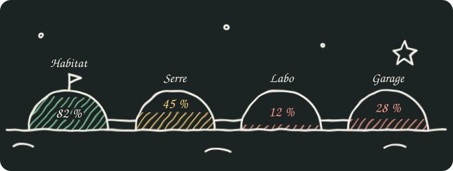
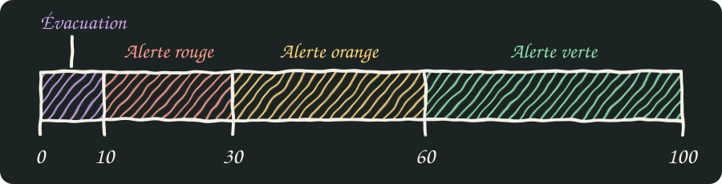
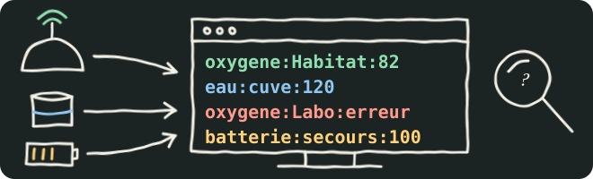
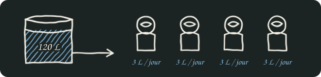
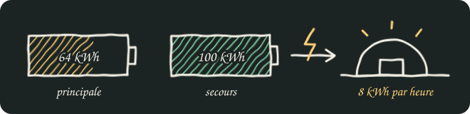
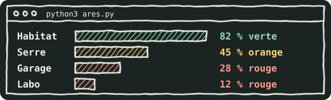

# Python

## Séance 1 : écrire un script

<p style="text-align:center; color:gray;">
  Tanguy Bernard
</p>

Note:
Déroulé (3h30) : positionnement 15 min, intro 15 min, variables 15 min, conditions 30 min, pause 15 min, boucles 30 min, listes et dictionnaires 35 min, fonctions 10 min, kata du journal de bord 45 min (quatre paliers).
Chaque notion : syntaxe, puis « que va afficher ce code ? » sur papier, puis mob programming. Pas de mob sur les variables : la première pratique arrive avec les conditions.
Le deck contient volontairement plus que ce qui tient en 3h30. À sauter en priorité si le temps manque, dans cet ordre :
1. le mob « tout remettre en fonctions » (20 min)
2. les paliers 2 à 4 du kata (eau, batteries, tableau de bord et sa version en couleur), en commençant par la couleur puis les batteries
3. les slides while et break / continue
4. le mob « le tour des dômes »
Ne pas sauter : les questions « que va afficher ce code ? » et le palier 1 du kata.

----

## Objectif des deux séances

Savoir écrire seul un script Python :

* variables, conditions, boucles
* listes et dictionnaires
* fonctions
* classes (séance 2)

Note:
À dire à l'oral, comment on travaille : un peu de syntaxe, puis « que va afficher ce code ? » sur papier sans exécuter, puis mob programming (une personne tape, la salle dicte).
Insister : l'examen est sur papier, sans machine, donc les questions « que va afficher ce code ? » sont l'entraînement direct.
Distribuer le positionnement papier maintenant (15 min, non noté).

----

<!-- .slide: data-background-image="assets/mars-outpost.jpg" data-background-opacity="0.4" -->

## Le fil rouge : mission sur Mars

Vous écrivez le logiciel de bord de la base **Ares**.

On va surveiller les réserves, déclencher des alertes, simuler la consommation.

<p style="font-size:0.4em; color:#ccc; margin-top:2em;">Image : « A Mars Outpost », NASA, par Pat Rawlings (Eagle Engineering Incorporated)</p>

----

## La base Ares



Chaque dôme a une réserve d'oxygène, en %.

```python
oxygene = {"Habitat": 82, "Serre": 45,
           "Labo": 12, "Garage": 28}
```

Note:
Ce schéma sert de référence à tous les mobs : mêmes dômes, mêmes valeurs. Les couleurs sont les niveaux d'alerte qu'on programmera dans les conditions.

---

## Python en deux minutes

* Langage **interprété** : on lance le fichier directement, sans étape de compilation
* **Typage dynamique** : pas de type à déclarer
* L'**indentation** fait partie de la syntaxe
* Pas de `;` ni d'accolades
* Son nom vient des **Monty Python**, pas du serpent

Note:
Anecdote : Guido van Rossum, le créateur du langage, lisait les scripts de la série comique de la BBC « Monty Python's Flying Circus » quand il a cherché un nom court et un peu mystérieux. C'est écrit dans le tutoriel officiel (chapitre 1, « Mise en bouche ») et dans la FAQ du site. D'où les exemples avec « spam » et « eggs » qu'ils croiseront dans la documentation.
Source pour toute la séance : tutoriel officiel Python en français, https://docs.python.org/fr/3/tutorial/
Précision si la question est posée : Python compile en interne le code en bytecode, mais c'est invisible, il n'y a rien à lancer.

----

## À quoi sert Python ?


<div style="display:grid; grid-template-columns:repeat(4, 1fr); width:95%; margin:0 auto; font-size:0.62em; line-height:1.3;">
<div>le site est écrit en Python</div>
<div>les recommandations</div>
<div>entraîné avec une bibliothèque Python</div>
<div>la première image, en 2019</div>
</div>

Vous l'avez sans doute utilisé aujourd'hui.

Note:
Poser la question avant de cliquer : « Qui a ouvert Instagram ce matin ? Écouté Spotify ? Posé une question à ChatGPT ? » Roulette possible : faire deviner à un étudiant ce que ces quatre choses ont en commun. Puis commenter les quatre exemples, déjà affichés.

Ce qui est sourcé, à dire tel quel :
- Instagram : son équipe technique écrit qu'elle fait tourner le plus grand déploiement au monde de Django, un framework web écrit en Python (blog Instagram Engineering, 2016).
- Spotify : Python sert aux services côté serveur et à l'analyse de données, dont les recommandations (blog Spotify Engineering, 2013). Netflix : Python sert à entraîner les modèles de recommandation (blog technique Netflix, 2019).
- ChatGPT : OpenAI, qui l'a créé, a annoncé en 2020 utiliser PyTorch, une bibliothèque Python, pour ses modèles.
- Trou noir : l'image de 2019 a été reconstruite avec des outils Python, dont NumPy (étude de cas sur numpy.org).
Nuance honnête : ces sites ne sont pas écrits uniquement en Python, et les articles de Spotify et d'Instagram ont plusieurs années.

Pourquoi les data scientists et les matheux l'ont adopté, trois raisons à donner à l'oral :
1. Ce ne sont pas des développeurs de métier. Python se lit presque comme du pseudo-code : pas de types à déclarer, pas d'accolades, pas de compilation. On se concentre sur le problème.
2. On travaille en interactif : on tape une ligne, on voit le résultat, on corrige. Idéal pour explorer des données.
3. Les bibliothèques. Python est lent pour le calcul pur, mais NumPy, pandas ou PyTorch sont écrites en C et en C++ : Python sert de télécommande simple à du code très rapide. Et tout est gratuit et open source.
Le point commun à faire sortir : peu de code pour exprimer une idée.
Lien avec le cours : nous, on commence par les scripts ; le graphique arrive en séance 2.

Sources :
https://instagram-engineering.com/web-service-efficiency-at-instagram-with-python-4976d078e366
https://engineering.atspotify.com/2013/3/how-we-use-python-at-spotify
https://openai.com/index/openai-pytorch/
https://numpy.org/case-studies/blackhole-image

----

## Lancer du code

Un fichier `ares.py` :

```python
print("Base Ares en ligne")
```

Dans le terminal :

```bash
python3 ares.py
```

Ou la console interactive, pour tester une ligne : `python3`

Note:
Faire vérifier `python3 --version` à tout le monde. Prévoir un plan B en ligne pour les postes sans Python.

---

## Variables et types

Note:
Source : tutoriel officiel, chapitre 3 « Introduction informelle à Python » (nombres, chaînes). Les f-strings sont au chapitre 7.
https://docs.python.org/fr/3/tutorial/introduction.html

----

## Déclarer une variable

TypeScript

```ts
const dome: string = "Habitat";
let oxygene: number = 82;
```

Python

```python
dome = "Habitat"
oxygene = 82
```

Pas de `const`, pas de `let`, pas de type obligatoire.

----

## Les types de base

```python
equipage = 4          # int
temperature = -62.5   # float
dome = "Habitat"      # str
pressurise = True     # bool  (True / False avec majuscule)
signal = None         # l'équivalent de null

print(type(temperature))   # <class 'float'>
```

----

## Les opérations

```python
print(7 + 2)    # 9
print(7 / 2)    # 3.5   division : toujours un float
print(7 // 2)   # 3     division entière
print(7 % 2)    # 1     reste
print(2 ** 3)   # 8     puissance
```

----

## Afficher du texte : les f-strings

TypeScript

```ts
console.log(`${dome} : ${oxygene} %`);
```

Python

```python
print(f"{dome} : {oxygene} %")
```

Le `f` devant les guillemets est obligatoire.

----

## Convertir

Un capteur envoie toujours du texte.

```python
texte = "82"
oxygene = int(texte)      # 82
precis = float(texte)     # 82.0
retour = str(oxygene)     # "82"

print("Oxygène : " + str(oxygene))
```

`"Oxygène : " + 82` provoque une erreur : Python ne convertit pas tout seul.

----

## Que va afficher ce code ?

```python
rations = 10
equipage = 4
print(rations / equipage)
print(rations // equipage)
print(rations % equipage)
print(f"{rations} rations pour {equipage}")
```

```text
2.5
2
2
10 rations pour 4
```
<!-- .element: class="fragment" -->

Note:
Réponse sur papier, 2 minutes, puis on clique. Demander à quelqu'un d'expliquer pourquoi 2.5 et pas 2.
Sens métier : 2 rations entières chacun, il en reste 2.

---

## Conditions

Note:
Source : tutoriel officiel, chapitre 4 « D'autres outils de contrôle de flux » (4.1 pour if).
https://docs.python.org/fr/3/tutorial/controlflow.html

----

## if / elif / else

TypeScript

```ts
if (oxygene >= 20) {
  console.log("Habitable");
} else {
  console.log("Évacuation");
}
```

Python

```python
if oxygene >= 20:
    print("Habitable")
else:
    print("Évacuation")
```

Deux points, puis **4 espaces** d'indentation.

----

## Plusieurs cas : elif

```python
if oxygene >= 60:
    alerte = "verte"
elif oxygene >= 30:
    alerte = "orange"
elif oxygene >= 10:
    alerte = "rouge"
else:
    alerte = "évacuation"
```

Python s'arrête au **premier** cas vrai.

----

## Comparer et combiner

| TypeScript | Python |
|---|---|
| `===` | `==` |
| `!==` | `!=` |
| `&&` | `and` |
| <code>&#124;&#124;</code> | `or` |
| `!` | `not` |

```python
if oxygene >= 20 and not sas_ouvert:
    print("Habitable")
```

----

## L'indentation compte

```python
oxygene = 8
if oxygene >= 20:
    print("Habitable")
print("Casques retirés")
```

`Casques retirés` s'affiche **toujours** : la ligne n'est pas dans le `if`.

----

## Que va afficher ce code ?

```python
oxygene = 70
if oxygene >= 30:
    print("A")
elif oxygene >= 60:
    print("B")
else:
    print("C")
print("D")
```

```text
A
D
```
<!-- .element: class="fragment" -->

Note:
Piège : beaucoup répondent A B D. Rappeler que elif n'est testé que si le if est faux.

----

## Mob : le niveau d'alerte



Afficher le niveau d'alerte de la variable `oxygene`.

* `60` tout rond : `Alerte verte`
* hors de 0 à 100 : `Capteur en panne`

Note:
Roulette : nouveau pilote.
Laisser la salle découvrir que l'ordre des tests compte. Tester avec 100, 0, 60, 29.9, -5 et 130.
Corrigé :
if oxygene < 0 or oxygene > 100:
    print("Capteur en panne")
elif oxygene >= 60:
    print("Alerte verte")
elif oxygene >= 30:
    print("Alerte orange")
elif oxygene >= 10:
    print("Alerte rouge")
else:
    print("Évacuation")

---

## Boucles

Note:
Source : tutoriel officiel, chapitre 4 (for, range, break et continue). while est présenté au chapitre 3.
https://docs.python.org/fr/3/tutorial/controlflow.html

----

## for : parcourir

TypeScript

```ts
for (const niveau of niveaux) {
  console.log(niveau);
}
```

Python

```python
for niveau in niveaux:
    print(niveau)
```

----

## range : compter

```python
for jour in range(5):
    print(jour)          # 0 1 2 3 4

for jour in range(1, 4):
    print(jour)          # 1 2 3
```

La borne de fin est **exclue**.

----

## while

Une fuite : le dôme perd 10 % par heure.

```python
oxygene = 30
while oxygene > 0:
    print(f"Il reste {oxygene} %")
    oxygene = oxygene - 10
```

Pas de `oxygene--` en Python : on écrit `oxygene -= 10`.

----

## break et continue

```python
for niveau in [70, 25, 90, 4]:
    if niveau < 10:
        break         # on sort de la boucle
    if niveau < 30:
        continue      # on passe au niveau suivant
    print(niveau)
```

Affiche `70` puis `90`.

----

## Que va afficher ce code ?

```python
energie = 0
for jour in range(1, 5):
    if jour % 2 == 0:
        energie = energie + jour
print(energie)
```

```text
6
```
<!-- .element: class="fragment" -->

Note:
range(1, 5) donne 1, 2, 3, 4. Seuls 2 et 4 sont pairs. Faire dérouler la boucle au tableau, ligne par ligne, avec la valeur de energie.

----

## Mob : le tour des dômes

```python
niveaux = [82, 45, 12, 67, 28, 30]
```

Un dôme est en alerte sous 30 %.

1. Afficher chaque niveau avec `OK` ou `Alerte`
2. Compter le nombre de dômes en alerte
3. Calculer la moyenne **sans** utiliser `sum`

Résultat attendu : `2 en alerte, moyenne 44.0`

Note:
Roulette : nouveau pilote.
Corrigé :
alertes = 0
total = 0
for niveau in niveaux:
    if niveau < 30:
        print(f"{niveau} Alerte")
        alertes += 1
    else:
        print(f"{niveau} OK")
    total += niveau
moyenne = total / len(niveaux)
print(f"{alertes} en alerte, moyenne {moyenne}")

---

## Listes et dictionnaires

Note:
Source : tutoriel officiel, chapitre 3 pour les listes, chapitre 5 « Structures de données » pour les dictionnaires et leur parcours.
https://docs.python.org/fr/3/tutorial/datastructures.html

----

## Les listes

```python
niveaux = [82, 45, 12]

print(niveaux[0])     # 82   premier élément
print(niveaux[-1])    # 12   dernier élément
print(len(niveaux))   # 3

niveaux.append(67)    # ajoute à la fin
niveaux[1] = 50       # modifie
```

En TypeScript : `niveaux.length` et `niveaux.push(67)`.

----

## Fonctions utiles sur une liste

```python
niveaux = [82, 45, 12]

print(sum(niveaux))      # 139
print(max(niveaux))      # 82
print(min(niveaux))      # 12
print(sorted(niveaux))   # [12, 45, 82]
print(45 in niveaux)     # True
```

----

## Les dictionnaires

L'équivalent d'un objet `{ clé: valeur }`.

```python
oxygene = {"Habitat": 82, "Serre": 45}

print(oxygene["Habitat"])    # 82
oxygene["Labo"] = 12         # ajoute
oxygene["Serre"] = 50        # modifie
print("Serre" in oxygene)    # True
```

Les clés sont entre guillemets. `oxygene["Garage"]` provoque une erreur `KeyError`.

----

## Parcourir un dictionnaire

```python
oxygene = {"Habitat": 82, "Serre": 45}

for dome in oxygene:
    print(dome)                   # les clés

for dome, niveau in oxygene.items():
    print(f"{dome} : {niveau}")   # clé et valeur
```

----

## Une liste de dictionnaires

```python
base = [
    {"nom": "Habitat", "oxygene": 82},
    {"nom": "Serre", "oxygene": 45},
]

for dome in base:
    print(dome["nom"])
```

C'est la forme d'un JSON renvoyé par une API.

----

## Que va afficher ce code ?

```python
oxygene = {"Habitat": 82, "Serre": 45}
oxygene["Serre"] = 20
oxygene["Labo"] = 12

alertes = []
for dome, niveau in oxygene.items():
    if niveau < 30:
        alertes.append(dome)

print(len(oxygene))
print(alertes)
```

```text
3
['Serre', 'Labo']
```
<!-- .element: class="fragment" -->

----

## Mob : le rapport de la base

```python
base = {"Habitat": 82, "Serre": 45, "Labo": 12, "Garage": 28}
```

1. Afficher le nom du dôme le plus critique (le niveau le plus bas)
2. Construire la liste des dômes en alerte (sous 30 %)
3. Construire un dictionnaire `etats` : dôme vers `OK` ou `Alerte`

Note:
Roulette : nouveau pilote.
Corrigé :
critique = None
for dome, niveau in base.items():
    if critique is None or niveau < base[critique]:
        critique = dome
print(critique)

alertes = []
etats = {}
for dome, niveau in base.items():
    if niveau < 30:
        alertes.append(dome)
        etats[dome] = "Alerte"
    else:
        etats[dome] = "OK"

---

## Fonctions

Note:
Source : tutoriel officiel, chapitre 4 (définir des fonctions, valeurs par défaut, arguments nommés).
https://docs.python.org/fr/3/tutorial/controlflow.html

----

## Définir une fonction

TypeScript

```ts
function autonomie(eau: number, conso: number): number {
  return eau / conso;
}
```

Python

```python
def autonomie(eau, conso):
    return eau / conso

print(autonomie(120, 12))   # 10.0
```

----

## print n'est pas return

```python
def double(x):
    print(x * 2)

resultat = double(5)
print(resultat)
```

Affiche `10` puis `None`.

Sans `return`, une fonction renvoie `None`.

----

## Valeurs par défaut et arguments nommés

```python
def en_alerte(niveau, seuil=30):
    return niveau < seuil

print(en_alerte(25))             # True
print(en_alerte(25, 20))         # False
print(en_alerte(25, seuil=20))   # False
```

----

## Indiquer les types (facultatif)

```python
def moyenne(niveaux: list[float]) -> float:
    return sum(niveaux) / len(niveaux)
```

Python ne vérifie pas ces types à l'exécution : ils servent à la lecture et à l'éditeur.

----

## Que va afficher ce code ?

```python
def etat(niveau):
    if niveau < 30:
        return "Alerte"
    return "OK"

def rapport(dome, niveau):
    print(f"{dome} : {etat(niveau)}")

rapport("Labo", 12)
print(etat(30))
```

```text
Labo : Alerte
OK
```
<!-- .element: class="fragment" -->

----

## Mob : tout remettre en fonctions

```python
base = {"Habitat": 82, "Serre": 45, "Labo": 12, "Garage": 28}
```

Écrire :

* `moyenne(niveaux)`
* `alerte(niveau)` : verte, orange, rouge, évacuation
* `domes_en_alerte(base)` : sous 30 %
* `afficher_rapport(base)` : une ligne par dôme

Note:
Peut être sauté si la séance est en retard : le kata qui suit fait aussi pratiquer les fonctions.
Roulette : nouveau pilote par fonction.
On réutilise le code des mobs précédents : l'objectif est de voir le script se structurer.
Corrigé :
def moyenne(niveaux):
    return sum(niveaux) / len(niveaux)

def alerte(niveau):
    if niveau >= 60:
        return "verte"
    elif niveau >= 30:
        return "orange"
    elif niveau >= 10:
        return "rouge"
    return "évacuation"

def domes_en_alerte(base):
    resultat = []
    for dome, niveau in base.items():
        if niveau < 30:
            resultat.append(dome)
    return resultat

def afficher_rapport(base):
    for dome, niveau in base.items():
        print(f"{dome} : {niveau} % ({alerte(niveau)})")

----

## Découper du texte

Les capteurs écrivent dans un journal, une ligne par mesure.

```python
ligne = "oxygene:Serre: 45 "

morceaux = ligne.split(":")
# ['oxygene', 'Serre', ' 45 ']

capteur = morceaux[0]          # 'oxygene'
dome = morceaux[1]             # 'Serre'
valeur = morceaux[2].strip()   # '45'

print(valeur.isdigit())        # True
```

Note:
Deux minutes, juste avant le kata. Source : tutoriel officiel, chapitre 3 (chaînes) et la référence des méthodes de str.
https://docs.python.org/fr/3/library/stdtypes.html#string-methods

----

## Kata : le journal de bord



Tous les capteurs de la base écrivent dans le même journal.

À vous de l'analyser.

Note:
Kata de fin de séance, 45 minutes, en mob. Roulette : nouveau pilote toutes les 4 à 5 minutes.
Différence avec les mobs précédents : l'énoncé ne donne pas les étapes. C'est la salle qui découpe le problème en fonctions avant de taper. Ne pas souffler le découpage ; si la salle bloque plus de 3 minutes, proposer la première fonction seulement.
Quatre paliers. Le palier 1 est l'objectif ; les suivants sont là si le groupe avance vite. Si le temps manque, sauter les batteries (palier 3) plutôt que le tableau de bord (palier 4), qui termine la séance sur quelque chose de visuel.

----

## Le journal

```python
journal = [
    "oxygene:Habitat:82",
    "eau:cuve:150",
    "oxygene:Serre: 45 ",
    "batterie:principale:64",
    "oxygene:Labo:erreur",
    "oxygene:Garage:28",
    "eau:cuve:120",
    "batterie:secours:100",
    "oxygene:Labo:12",
]
```

Chaque ligne : `capteur:nom:valeur`

Note:
Laisser cette slide affichée le temps que le pilote recopie la liste, ou la donner dans un fichier pour gagner cinq minutes.
Faire remarquer à l'oral, avant de coder : les lignes sont dans l'ordre d'arrivée, un même capteur peut écrire plusieurs fois, une valeur peut être illisible, une autre a des espaces.

----

## Palier 1 : l'oxygène

Ne garder que les lignes `oxygene`.

Si un dôme est mesuré plusieurs fois, la dernière mesure lisible compte.

```text
Niveaux : {'Habitat': 82, 'Serre': 45,
           'Garage': 28, 'Labo': 12}
En alerte : ['Garage', 'Labo']
Lignes illisibles : 1
```

Note:
Un découpage possible :
- capteur(ligne), nom(ligne) : les deux premiers champs
- valeur(ligne) : la valeur en entier, ou None si elle est illisible
- niveaux_oxygene(journal) : le dictionnaire dôme vers niveau
- domes_en_alerte(niveaux) : la liste des dômes sous 30 %
Corrigé :
def capteur(ligne):
    return ligne.split(":")[0]

def nom(ligne):
    return ligne.split(":")[1]

def valeur(ligne):
    texte = ligne.split(":")[2].strip()
    if texte.isdigit():
        return int(texte)
    return None

def niveaux_oxygene(journal):
    niveaux = {}
    for ligne in journal:
        if capteur(ligne) == "oxygene" and valeur(ligne) is not None:
            niveaux[nom(ligne)] = valeur(ligne)
    return niveaux

def domes_en_alerte(niveaux):
    resultat = []
    for dome, niveau in niveaux.items():
        if niveau < 30:
            resultat.append(dome)
    return resultat

def compter_illisibles(journal):
    compteur = 0
    for ligne in journal:
        if valeur(ligne) is None:
            compteur += 1
    return compteur

niveaux = niveaux_oxygene(journal)
print(f"Niveaux : {niveaux}")
print(f"En alerte : {domes_en_alerte(niveaux)}")
print(f"Lignes illisibles : {compter_illisibles(journal)}")
Sur la slide, la ligne « Niveaux » est coupée en deux pour tenir dans le cadre : Python l'affiche sur une seule ligne.
Points à faire sortir : le Labo apparaît deux fois, la seconde mesure est lisible et c'est elle qu'on garde ; « is not None » et pas un simple « if valeur(ligne) », sinon un niveau à 0 serait ignoré.

----

## Palier 2 : l'eau



La réserve est la **dernière** mesure `eau`. L'équipage : 4 personnes, 3 litres par jour chacune.

```text
Autonomie en eau : 10.0 jours
```

Note:
Le dessin montre 120 L : c'est la dernière mesure du journal, pas la première (150).
Corrigé :
def reserve_eau(journal):
    reserve = 0
    for ligne in journal:
        if capteur(ligne) == "eau":
            reserve = valeur(ligne)
    return reserve

def autonomie_eau(journal, equipage=4, conso=3):
    return reserve_eau(journal) / (equipage * conso)

print(f"Autonomie en eau : {autonomie_eau(journal)} jours")
Pièges à faire sortir : sans les parenthèses, 120 / 4 * 3 donne 90.0 ; et si on prend la première mesure (150), on trouve 12.5.
Bon endroit pour réutiliser les valeurs par défaut vues juste avant (equipage=4, conso=3).

----

## Palier 3 : les batteries



Une ligne `batterie` donne l'énergie restante, en kWh. La base en consomme 8 par heure.

autonomie = énergie totale ÷ 8

```text
Autonomie batterie : 20.5 heures
```

Note:
Le calcul, à faire dire par la salle avant de coder : il y a deux batteries, 64 kWh et 100 kWh, donc 164 kWh au total. À 8 kWh par heure, 164 / 8 = 20,5 heures.
Si quelqu'un demande ce qu'est un kWh : une quantité d'énergie. Une batterie de 64 kWh peut fournir 8 kWh pendant 8 heures.
Différence avec l'eau : pour l'eau on garde la dernière mesure, pour les batteries on additionne toutes les lignes.
Corrigé :
def energie_batteries(journal):
    total = 0
    for ligne in journal:
        if capteur(ligne) == "batterie":
            total += valeur(ligne)
    return total

def autonomie_batterie(journal, conso=8):
    return energie_batteries(journal) / conso

print(f"Autonomie batterie : {autonomie_batterie(journal)} heures")

----

## Palier 4 : le tableau de bord



Une ligne par dôme. La barre fait un caractère pour 5 %.

```python
print("█" * 3)                 # ███
print("Labo".ljust(8) + "|")   # Labo    |
```

Note:
Le dessin montre le résultat attendu. Dans le vrai terminal, les barres sont des caractères pleins :
Habitat  ████████████████     82 % verte
Serre    █████████            45 % orange
Garage   █████                28 % rouge
Labo     ██                   12 % rouge
Deux outils à montrer, déjà sur la slide : multiplier une chaîne, et ljust() pour aligner les colonnes. Le caractère █ se copie depuis la slide ; à défaut, utiliser # .
Corrigé (réutilise la fonction alerte du mob « tout remettre en fonctions » ; si ce mob a été sauté, afficher seulement la barre et le pourcentage) :
def afficher_tableau(niveaux):
    for dome, niveau in niveaux.items():
        barre = "█" * (niveau // 5)
        print(f"{dome.ljust(8)} {barre.ljust(20)} {niveau} % {alerte(niveau)}")

afficher_tableau(niveaux_oxygene(journal))
Annoncer la suite : en séance 2, on fera le même tableau de bord avec un vrai graphique, et on verra try / except pour la ligne illisible.

----

## Palier 4 bis : en couleur

Un code de couleur avant le texte, `FIN` après.

```python
VERT = "\033[92m"
JAUNE = "\033[93m"
ROUGE = "\033[91m"
FIN = "\033[0m"

print(VERT + "████" + FIN)
```

Chaque barre prend la couleur de son alerte.

Note:
Bonus, 10 minutes, sans rien installer. Ces codes ne sont pas du Python : ce sont des « séquences d'échappement ANSI », un standard que les terminaux comprennent. Python se contente d'afficher le texte, c'est le terminal qui colore.
Fonctionne dans le terminal de Mac et Linux, dans celui de VS Code et dans Windows Terminal. Sur une très vieille invite de commandes Windows, les codes s'affichent tels quels : dans ce cas, utiliser le terminal de VS Code.
Piège à faire sortir : si on oublie FIN, tout le reste du terminal reste coloré.
Corrigé :
def couleur(niveau):
    if niveau >= 60:
        return VERT
    elif niveau >= 30:
        return JAUNE
    return ROUGE

def afficher_tableau(niveaux):
    for dome, niveau in niveaux.items():
        barre = "█" * (niveau // 5)
        print(f"{dome.ljust(8)} {couleur(niveau)}{barre.ljust(20)}{FIN} {niveau} % {alerte(niveau)}")
Pour aller plus loin, à citer seulement : la bibliothèque rich fait des tableaux et des couleurs sans écrire ces codes, mais elle s'installe avec pip.

---

## Récap de la séance 1

* Pas de type à déclarer, pas d'accolades : **l'indentation** délimite les blocs
* `/` donne toujours un float, `//` la division entière
* `elif` n'est testé que si les tests précédents sont faux
* `range(1, 5)` s'arrête à 4
* Une fonction sans `return` renvoie `None`

----

## Pour la suite

* Relire le tutoriel officiel, chapitres 3 à 5

  https://docs.python.org/fr/3/tutorial/

* Séance 2 : classes, erreurs, un graphique, et l'évaluation sur papier

* Installer matplotlib, dans le dossier du projet :

```bash
python3 -m venv .venv
source .venv/bin/activate
python3 -m pip install matplotlib
```

Note:
Sous Windows, la deuxième ligne devient : .venv\Scripts\activate
Pourquoi un environnement virtuel (venv) : sur Mac et Linux récents, pip refuse d'installer dans le Python du système. Source : tutoriel officiel, chapitre 12 « Environnements virtuels et paquets ».
https://docs.python.org/fr/3/tutorial/venv.html
Dire que ce n'est pas grave si l'installation échoue : le graphique sera aussi fait à l'écran projeté.
