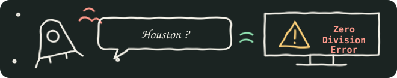
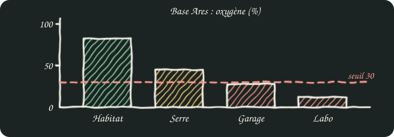

# Python

## Séance 2 : structurer son code

Note:
Déroulé (3h30) : rappel 10 min, classes 50 min, exceptions 30 min, pause 15 min, modules et graphique en démo 20 min, mob de synthèse 25 min, évaluation papier 1 h.
En plus si le groupe avance vite : le mob « le graphique de la base » (15 min). L'examen ne porte pas sur matplotlib.

----

## Au programme

* Rappel de la séance 1
* Classes et objets
* Erreurs et exceptions
* Découper en plusieurs fichiers
* Évaluation sur papier (1 h)

----

## Rappel : que va afficher ce code ?

```python
def moyenne(valeurs):
    return sum(valeurs) / len(valeurs)

releves = {"Habitat": [80, 90], "Labo": [10, 25]}

for dome, niveaux in releves.items():
    m = moyenne(niveaux)
    if m >= 30:
        print(f"{dome} : {m}")
```

```text
Habitat : 85.0
```
<!-- .element: class="fragment" -->

Note:
Roulette : tirer deux ou trois prénoms pour expliquer chacun une ligne (dictionnaire de listes, items(), division qui donne un float, Labo à 17.5 donc non affiché).

---

## Classes et objets

Note:
Source : tutoriel officiel, chapitre 9 « Classes » (9.3 pour la syntaxe, 9.6 pour la convention du tiret bas).
https://docs.python.org/fr/3/tutorial/classes.html

----

## Pourquoi une classe ?

Jusqu'ici, un dôme est un dictionnaire :

```python
dome = {"nom": "Habitat", "oxygene": 82}
```

Rien n'empêche d'écrire `dome["oxygène"]` ou d'oublier une clé.

Une classe regroupe **les données** et **les fonctions qui vont avec**.

----

## Définir une classe

TypeScript

```ts
class Dome {
  nom: string;
  constructor(nom: string) {
    this.nom = nom;
  }
}
```

Python

```python
class Dome:
    def __init__(self, nom):
        self.nom = nom
```

----

## Créer un objet

```python
habitat = Dome("Habitat")
print(habitat.nom)    # Habitat
```

* Pas de `new`
* `__init__` initialise l'objet : c'est le rôle du constructeur
* `self` est l'équivalent de `this`

----

## self : toujours écrit, jamais passé

```python
class Dome:
    def __init__(self, nom, oxygene):
        self.nom = nom
        self.oxygene = oxygene

    def consommer(self, quantite):
        self.oxygene -= quantite

habitat = Dome("Habitat", 82)
habitat.consommer(10)
```

`self` est le premier paramètre de **chaque** méthode, mais on ne le donne pas à l'appel.

----

## Des méthodes qui s'appellent entre elles

```python
class Dome:
    def __init__(self, nom, oxygene):
        self.nom = nom
        self.oxygene = oxygene

    def en_alerte(self):
        return self.oxygene < 30

    def etat(self):
        if self.en_alerte():
            return "Alerte"
        return "OK"
```

Pour appeler une autre méthode de l'objet : `self.en_alerte()`.

----

## Afficher un objet : `__str__`

```python
class Dome:
    def __init__(self, nom):
        self.nom = nom

    def __str__(self):
        return f"Dôme {self.nom}"

print(Dome("Habitat"))   # Dôme Habitat
```

Sans `__str__`, on obtient `<__main__.Dome object at 0x...>`.

----

## Chaque objet a ses propres données

```python
habitat = Dome("Habitat", 82)
labo = Dome("Labo", 12)

habitat.consommer(10)

print(habitat.oxygene)   # 72
print(labo.oxygene)      # 12
```

----

## Public et privé

Python n'a pas de mot-clé `private`.

Par convention, un attribut qui commence par `_` ne doit pas être utilisé hors de la classe :

```python
class Dome:
    def __init__(self, nom, oxygene):
        self.nom = nom
        self._oxygene = oxygene
```

C'est une convention entre développeurs, pas une interdiction.

----

## Que va afficher ce code ?

```python
class Batterie:
    def __init__(self, charge=0):
        self.charge = charge

    def recharger(self):
        self.charge += 10

a = Batterie()
b = Batterie(50)
a.recharger()
a.recharger()
b.recharger()
print(a.charge)
print(b.charge)
```

```text
20
60
```
<!-- .element: class="fragment" -->

----

## Mob : la classe Dome

Écrire une classe `Dome` avec :

* un nom et un niveau d'oxygène (en %)
* `consommer(quantite)` et `recharger(quantite)`
* `alerte()` : `verte`, `orange`, `rouge` ou `évacuation`
* `__str__` : `Habitat : 72 % (verte)`

Puis créer deux dômes, les faire consommer et les afficher.

Note:
Roulette : nouveau pilote par méthode.
On reprend la fonction alerte de la séance 1 et on la déplace dans la classe.
Corrigé :
class Dome:
    def __init__(self, nom, oxygene):
        self.nom = nom
        self.oxygene = oxygene

    def consommer(self, quantite):
        self.oxygene -= quantite

    def recharger(self, quantite):
        self.oxygene += quantite

    def alerte(self):
        if self.oxygene >= 60:
            return "verte"
        elif self.oxygene >= 30:
            return "orange"
        elif self.oxygene >= 10:
            return "rouge"
        return "évacuation"

    def __str__(self):
        return f"{self.nom} : {self.oxygene} % ({self.alerte()})"
Questions à poser à la salle : que se passe-t-il si on consomme plus qu'il n'en reste ? Si on recharge au-delà de 100 % ? Transition vers les exceptions.

---

## Erreurs et exceptions

Note:
Source : tutoriel officiel, chapitre 8 « Erreurs et exceptions » (8.2 les exceptions, 8.3 try / except, 8.4 raise).
https://docs.python.org/fr/3/tutorial/errors.html

----

## Houston, on a un problème



```python
niveaux = []
print(sum(niveaux) / len(niveaux))
```

```text
Traceback (most recent call last):
  File "ares.py", line 2, in <module>
ZeroDivisionError: division by zero
```

Lire la **dernière ligne** : le type de l'erreur et son message.

Note:
Anecdote : la vraie phrase d'Apollo 13 (1970) est « Houston, we've had a problem ». La version au présent vient du film de 1995. Et c'était une mission vers la Lune, pas vers Mars.
Message à faire passer : quand Python s'arrête, il dit où et pourquoi. Une erreur se lit, elle ne se subit pas.

----

## Les erreurs les plus fréquentes

| Erreur | Cause |
|---|---|
| `SyntaxError` | deux points oubliés |
| `NameError` | variable inconnue |
| `TypeError` | `"Oxygène : " + 82` |
| `ValueError` | `int("abc")` |
| `KeyError` | clé absente |

Note:
Citer aussi à l'oral IndentationError (indentation incohérente) et IndexError (indice hors de la liste).

----

## Attraper une erreur

TypeScript

```ts
try {
  const mesure = JSON.parse(texte);
} catch (e) {
  console.log("Capteur illisible");
}
```

Python

```python
try:
    niveau = int(texte)
except ValueError:
    print("Capteur illisible")
```

On précise **quel type** d'erreur on attrape.

Note:
Lien avec le kata du journal de bord (séance 1) : la fonction valeur(ligne) testait isdigit() avant de convertir. Ici on tente la conversion et on rattrape l'échec. Faire réécrire valeur(ligne) à l'oral par un étudiant tiré à la roulette :
def valeur(ligne):
    try:
        return int(ligne.split(":")[2])
    except ValueError:
        return None
À noter : int() accepte les espaces autour du nombre, donc strip() n'est plus nécessaire.

----

## Signaler une erreur : raise

```python
class Dome:
    def __init__(self, nom, oxygene):
        self.nom = nom
        self.oxygene = oxygene

    def consommer(self, quantite):
        if quantite > self.oxygene:
            raise ValueError("Pas assez d'oxygène")
        self.oxygene -= quantite
```

`raise` est l'équivalent de `throw`.

----

## Que va afficher ce code ?

```python
def lire_capteur(texte):
    try:
        niveau = int(texte)
        print("A")
        return niveau
    except ValueError:
        print("B")
        return 0

total = lire_capteur("12") + lire_capteur("erreur")
print(total)
```

```text
A
B
12
```
<!-- .element: class="fragment" -->

Note:
Pour "erreur", int() lève ValueError avant le print("A") : on saute directement au except.

----

## Mob : sécuriser Dome

1. `consommer` refuse une quantité supérieure à la réserve avec `ValueError`
2. `recharger` ne dépasse jamais 100 %
3. Écrire un script qui essaie de consommer `90` dans le Labo (12 %) et affiche `Consommation refusée` au lieu de planter

Note:
Roulette : nouveau pilote.
Corrigé :
    def consommer(self, quantite):
        if quantite > self.oxygene:
            raise ValueError("Pas assez d'oxygène")
        self.oxygene -= quantite

    def recharger(self, quantite):
        self.oxygene += quantite
        if self.oxygene > 100:
            self.oxygene = 100

labo = Dome("Labo", 12)
try:
    labo.consommer(90)
except ValueError:
    print("Consommation refusée")

---

## Découper en fichiers

Note:
Source : tutoriel officiel, chapitre 6 « Modules ».
https://docs.python.org/fr/3/tutorial/modules.html

----

## Un fichier = un module

`dome.py`

```python
class Dome:
    def __init__(self, nom, oxygene):
        self.nom = nom
        self.oxygene = oxygene
```

`main.py`

```python
from dome import Dome

habitat = Dome("Habitat", 82)
```

En TypeScript : `import { Dome } from "./dome"`. Pas de mot-clé `export` en Python.

----

## La bibliothèque standard

Python est livré avec beaucoup de modules :

```python
import random
import math

print(random.randint(1, 100))   # de 1 à 100 inclus
print(math.sqrt(16))            # 4.0
```

----

## Les bibliothèques externes

Des milliers d'autres modules s'installent avec `pip`.

```bash
python3 -m venv .venv
source .venv/bin/activate
python3 -m pip install matplotlib
```

`matplotlib` : la bibliothèque de graphiques des data scientists.

Note:
Source : tutoriel officiel, chapitre 12 « Environnements virtuels et paquets ». https://docs.python.org/fr/3/tutorial/venv.html
C'était demandé à la fin de la séance 1. Ne pas passer plus de 5 minutes à dépanner les installations : ceux qui ne l'ont pas regardent l'écran projeté.
Le venv est un dossier qui contient les bibliothèques du projet, pour ne pas toucher au Python du système. Sous Windows : .venv\Scripts\activate

----

## Un graphique en dix lignes

```python
import matplotlib.pyplot as plt

niveaux = {"Habitat": 82, "Serre": 45,
           "Garage": 28, "Labo": 12}

domes = list(niveaux.keys())
valeurs = list(niveaux.values())

plt.bar(domes, valeurs)
plt.axhline(30, color="red", linestyle="--")
plt.ylabel("Oxygène (%)")
plt.title("Base Ares")
plt.show()
```

Note:
Démo par le formateur, 10 minutes. Source : documentation de matplotlib, tutoriel pyplot. https://matplotlib.org/stable/tutorials/pyplot.html
Lecture ligne à ligne : « import ... as plt » donne un nom court au module ; keys() et values() donnent les clés et les valeurs du dictionnaire ; bar() dessine les barres ; axhline() trace une ligne horizontale, ici le seuil d'alerte ; show() ouvre la fenêtre.
Lien avec la séance 1 : c'est le tableau de bord du kata, avec une vraie bibliothèque au lieu de caractères.
Lien avec « À quoi sert Python ? » : voilà pourquoi les data scientists l'utilisent, dix lignes pour un graphique.

----

## Mob de synthèse : la base

Écrire une classe `Base` dans `base.py` :

* `ajouter(dome)`
* `oxygene_moyen()`
* `en_alerte()` : la liste des dômes sous 30 %
* `plus_critique()` : le dôme qui a le niveau le plus bas

Dans `main.py` : créer une base de trois dômes et afficher le plus critique.

Note:
Roulette : nouveau pilote par méthode.
Corrigé :
class Base:
    def __init__(self):
        self.domes = []

    def ajouter(self, dome):
        self.domes.append(dome)

    def oxygene_moyen(self):
        total = 0
        for dome in self.domes:
            total += dome.oxygene
        return total / len(self.domes)

    def en_alerte(self):
        resultat = []
        for dome in self.domes:
            if dome.oxygene < 30:
                resultat.append(dome)
        return resultat

    def plus_critique(self):
        critique = self.domes[0]
        for dome in self.domes:
            if dome.oxygene < critique.oxygene:
                critique = dome
        return critique

----

## Mob : le graphique de la base

 <!-- .element: style="height:250px" -->

Une barre par dôme d'un objet `Base`, de la couleur de son alerte.

Note:
Premier exercice à sauter si le temps manque : la démo précédente suffit.
Roulette : nouveau pilote.
L'astuce à donner : bar() accepte color=une_liste, avec une couleur par barre.
Corrigé :
import matplotlib.pyplot as plt

def couleur(niveau):
    if niveau >= 60:
        return "green"
    elif niveau >= 30:
        return "orange"
    return "red"

def afficher_graphique(base):
    domes = []
    valeurs = []
    couleurs = []
    for dome in base.domes:
        domes.append(dome.nom)
        valeurs.append(dome.oxygene)
        couleurs.append(couleur(dome.oxygene))
    plt.bar(domes, valeurs, color=couleurs)
    plt.axhline(30, color="red", linestyle="--")
    plt.ylim(0, 100)
    plt.ylabel("Oxygène (%)")
    plt.title("Base Ares")
    plt.show()

---

## Récap de la séance 2

* `class`, `__init__`, `self` : pas de `new`, pas de `this`
* `self` est écrit dans chaque méthode, jamais passé à l'appel
* `__str__` décide de ce que `print` affiche
* `try` / `except TypeDErreur` pour attraper, `raise` pour signaler
* Un fichier `.py` est un module : `from fichier import Classe`

----

## Évaluation

* 1 heure, sur papier
* Sans machine, sans document
* QCM, lecture de code, correction d'erreurs, écriture de code

Note:
Ranger les ordinateurs. Distribuer les versions A et B en alternance.
